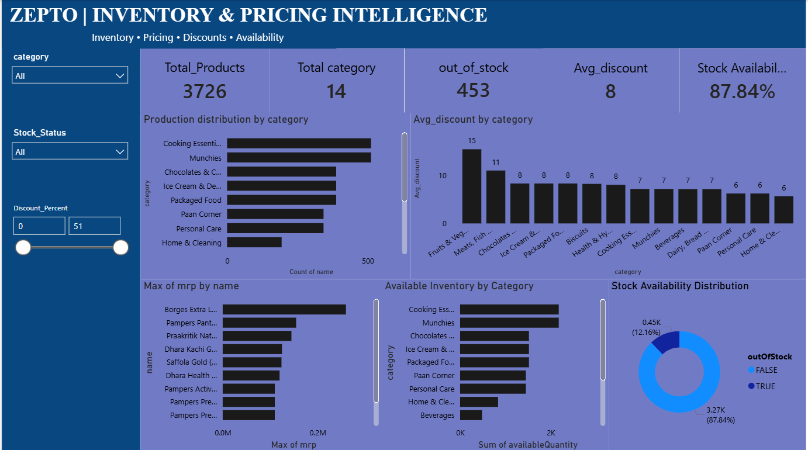

Zepto Inventory & Pricing Analytics Dashboard
Project Overview

This project analyzes Zepto product inventory and pricing data using MySQL and Microsoft Power BI. It provides insights into product availability, pricing, discounts, and inventory distribution across different categories through an interactive dashboard.

Project Objectives
Analyze product inventory and pricing information.
Identify out-of-stock products.
Compare discounts across product categories.
Analyze product distribution by category.
Identify the highest-priced products.
Track inventory availability through KPIs and visualizations.
Build an interactive dashboard for business insights.
Tools and Technologies
MySQL: Data storage, SQL queries, and data validation.
Microsoft Power BI: Interactive dashboard development and visualization.
DAX: KPI calculations and analytical measures.
Dataset Description

The dataset contains product-level information, including:

Product category
Product name
Maximum retail price (MRP)
Discount percentage
Available quantity
Discounted selling price
Product weight
Out-of-stock status
Product quantity
Data Analysis and SQL

The project involved:

Importing product data into MySQL.
Checking duplicate records and data quality.
Validating product prices, discounts, and quantities.
Analyzing inventory and pricing information.
Preparing product data for visualization.
Power BI Dashboard

The interactive dashboard includes:

Key Performance Indicators (KPIs)

Total Products
Total Categories
Average Discount Percentage
Out-of-Stock Products
Stock Availability Percentage

Visualizations

Product Distribution by Category
Average Discount by Category
Stock Availability Distribution
Top 10 Highest-Priced Products
Available Inventory by Category

Interactive Features

Category filtering
Stock-status filtering
Discount-range filtering
Skills Demonstrated
SQL and MySQL
Data Analysis
Data Validation
DAX Measures
KPI Development
Data Visualization
Interactive Dashboard Development
Business Intelligence
Microsoft Power BI
Key Business Insights

The dashboard helps users:

Understand product availability across categories.
Identify products that are out of stock.
Compare average discounts between categories.
Examine high-priced products.
Evaluate inventory distribution.

Specific numerical findings should be added after validating the final dashboard results.

Project Structure
zepto-inventory-pricing-analysis/
│
├── README.md
├── dataset/
│   └── zepto_v2.csv
├── sql/
│   └── zepto_analysis.sql
├── powerbi/
│   └── zepto_dashboard.pbix
└── screenshots/
    └── zepto_dashboard.png
## Power BI Dashboard

<h2 align="center">Zepto Inventory & Pricing Dashboard</h2>

  

